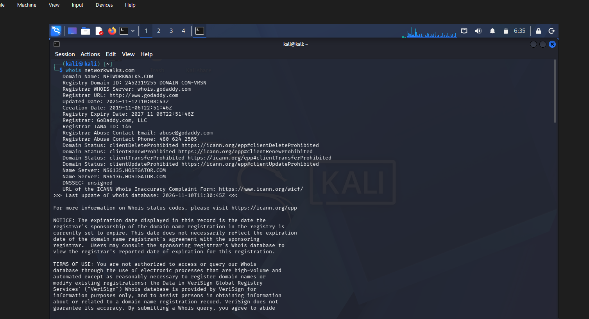
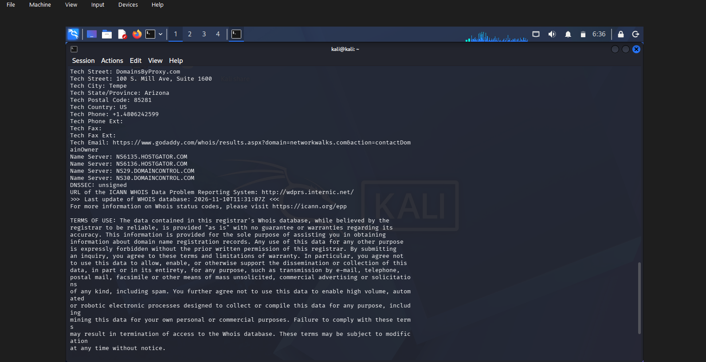
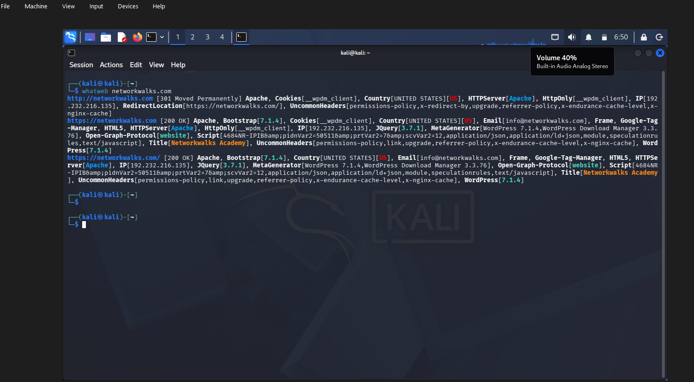
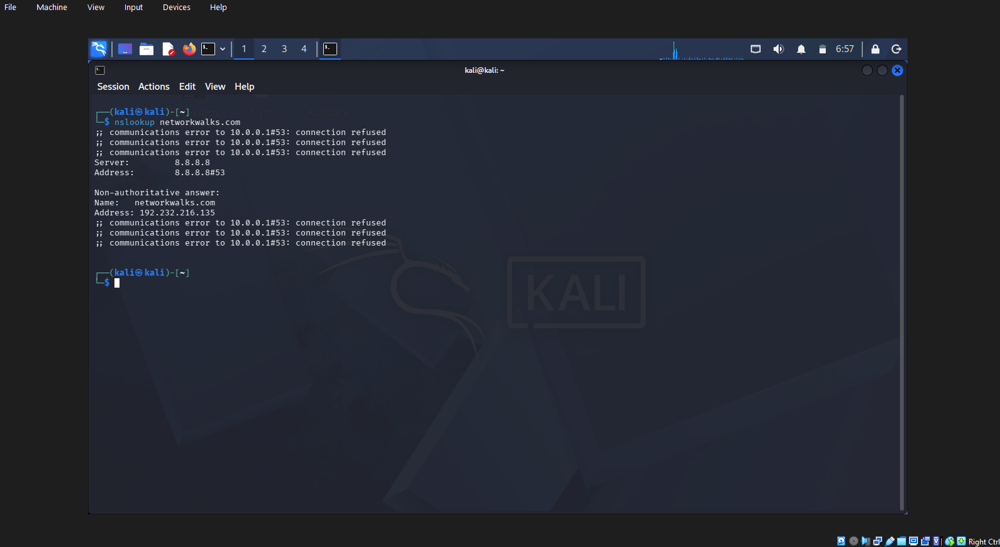
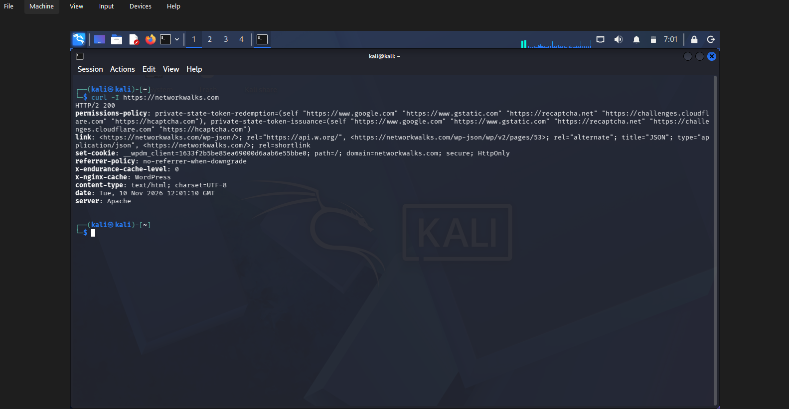
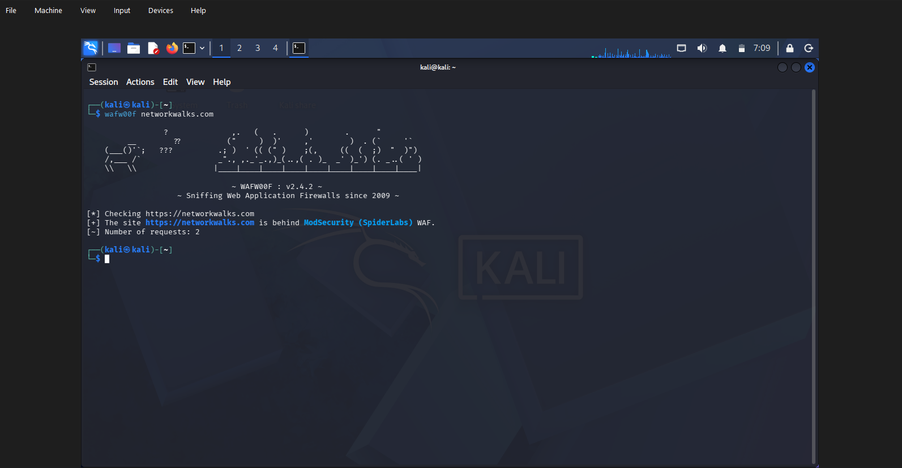
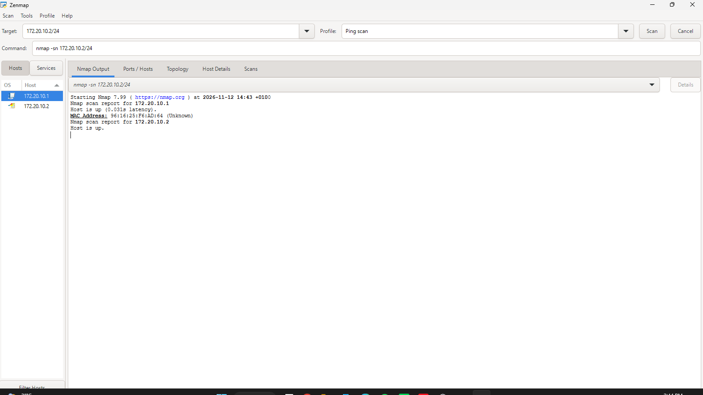
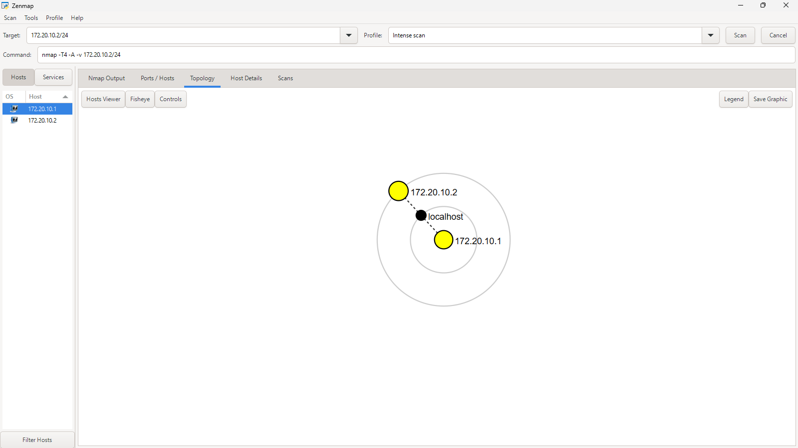

# 🔐 NETWORKWALKS PENETRATION TESTING PROJECT
## Footprinting & Network Scanning


---

**W2-PM-FINAL  |  CYBERSECURITY  |  NETWORKWALKS**

| Field | Detail |
|---|---|
| **Pentester Name (Cybersecurity Professional)** | **Oje Marvellous Ugochi** |
| **Program/Batch** | B084-Networkwalks |
| **Date** | 13 November 2026 |
| **Modules completed** | W2-PM1 (Multiple Kali Tools)<br>W2-PM5 (Zenmap Scanning) |
| **Client/Target** | 1. Networkwalks (secured written permission already)<br>2. My own local LAN Network |
| **Permission secured from client?** | Yes |
| **Phases covered** | **Phase 1:** Reconnaissance & Footprinting<br>**Phase 2:** Scanning & Network Discovery<br>**Phase 3-5:** In Progress |

---

## 📌 1. PROJECT OVERVIEW

This project documents practical cybersecurity activities completed during my NetworkWalks Cybersecurity Internship.

The project focuses on two important phases of penetration testing:

1. Footprinting and Reconnaissance.
2. Network Scanning and Discovery.

The exercises involved gathering publicly available information about an authorized target, identifying website technologies, examining DNS records, inspecting HTTP response headers, and discovering active devices on a local network.

The project was carried out using Kali Linux and various cybersecurity tools.

---

## 🎯 2. PROJECT OBJECTIVES

- Understand the footprinting and reconnaissance process.
- Identify technologies used by a website.
- Gather domain and DNS information.
- Inspect HTTP response headers.
- Identify Web Application Firewall technology.
- Discover active hosts on a local network.
- Understand basic network security risks.
- Develop practical penetration testing skills.

---

## 🛠️ 3. TOOLS USED

| Tool | Purpose |
|---|---|
| Kali Linux | Cybersecurity testing environment |
| WHOIS | Domain registration information |
| WhatWeb | Website technology identification |
| Nslookup | DNS lookup and domain resolution |
| cURL | HTTP response header inspection |
| Wafw00f | Web Application Firewall identification |
| DNSRecon | DNS enumeration |
| Zenmap | Graphical network scanning |
| Nmap | Network host discovery |

---

## 🔍 4. ACTIVITIES PERFORMED

### 4.1 FOOTPRINTING AND RECONNAISSANCE

Reconnaissance was performed against the authorized NetworkWalks domain using six Kali Linux tools.

**1. WHOIS**

Used to obtain publicly available domain registration information and identify name servers.

Command:

```bash
whois networkwalks.com
```

**2. WhatWeb**

Used to identify technologies used by the website.

Command:

```bash
whatweb https://networkwalks.com
```

Technologies identified:

- WordPress 7.0.4
- WP Download Manager 3.3.58

**3. Nslookup**

Used to resolve the domain name to its IP address.

Command:

```bash
nslookup networkwalks.com
```

Observed IP address:

`192.232.216.135`

**4. cURL**

Used to inspect HTTP response headers.

Command:

```bash
curl -I https://networkwalks.com
```

Observation:

The HTTP response headers were retrieved, and the `/wp-json/` endpoint was observed.

**5. Wafw00f**

Used to identify Web Application Firewall technology.

Command:

```bash
wafw00f https://networkwalks.com
```

Observed result:

ModSecurity (SpiderLabs).

**6. DNSRecon**

Used to collect DNS-related information.

Command:

```bash
dnsrecon -d networkwalks.com
```

Information collected included:

- Name servers
- Mail servers
- SPF/TXT records
- Service-related records
- DNS software information

---

### 4.2 NETWORK SCANNING WITH ZENMAP

Network scanning was performed to identify active devices within the authorized local network.

The Windows `ipconfig` command was used to check the local network configuration.

Command:

```powershell
ipconfig
```

Zenmap was then used to perform host discovery.

Nmap command:

```bash
nmap -sn 172.20.10.2/24
```

**Scan Results**

Two active hosts were identified:

| Host | Status |
|---|---|
| 172.20.10.1 | Up |
| 172.20.10.2 | Up |

MAC address observed:

`96:16:25:F6:AD:64`

Both hosts responded successfully to the network discovery scan.

**Observation:** The ping scan identified active hosts but did not check for open ports or vulnerabilities.

---

## 📊 5. RISK ANALYSIS AND POTENTIAL IMPACT

The following findings represent observations from the practical scanning activities and are not confirmed vulnerabilities.

| # | Risk / Finding | Evidence / Observation | Potential Impact | Risk Level |
|---|---|---|---|---|
| 1 | Network host discovery performed | Zenmap identified two active hosts: 172.20.10.1 and 172.20.10.2. | Helps reveal devices connected to the network for further security assessment. | Low |
| 2 | Active host detected at 172.20.10.1 | Nmap confirmed that 172.20.10.1 was up with a response latency of 0.031 seconds. | The host may require further assessment to identify running services and possible weaknesses. | Low |
| 3 | MAC address information exposed | Zenmap displayed MAC address 96:16:25:F6:AD:64 for 172.20.10.1. | May assist with device identification and network fingerprinting. | Low |
| 4 | Second active host detected | Nmap confirmed that 172.20.10.2 was reachable. | The device may require further inspection to determine its identity and security status. | Low |
| 5 | Multiple devices visible on local network | Zenmap displayed two discovered devices within the 172.20.10.0/24 network. | Unmonitored devices could increase network exposure if unauthorized access is possible. | Low |

**Important:** These are observations, not confirmed security vulnerabilities. No exploitation or vulnerability validation is claimed.

---

## 🛡️ 6. RECOMMENDATIONS

Based on the activities performed, the following recommendations are suggested:

1. Review publicly exposed technology details.
2. Keep website platforms and plugins updated.
3. Review DNS records periodically.
4. Configure appropriate HTTP security headers.
5. Maintain and monitor Web Application Firewall rules.
6. Perform authorized internal network discovery.
7. Maintain an updated inventory of network devices.
8. Investigate unknown devices.
9. Store scan outputs and screenshots securely.
10. Ensure future testing remains within written authorization.

---

## 💻 7. COMMANDS SUMMARY

The following commands were used during the practical exercises.

| No. | Command | Purpose |
|---|---|---|
| 1 | `whois networkwalks.com` | Domain information gathering |
| 2 | `whatweb https://networkwalks.com` | Website technology identification |
| 3 | `nslookup networkwalks.com` | DNS lookup |
| 4 | `curl -I https://networkwalks.com` | HTTP header inspection |
| 5 | `wafw00f https://networkwalks.com` | WAF identification |
| 6 | `dnsrecon -d networkwalks.com` | DNS enumeration |
| 7 | `ipconfig` | Local network configuration |
| 8 | `nmap -sn 172.20.10.2/24` | Network host discovery |

---

## 📝 8. CONCLUSION

The footprinting and network-scanning exercises introduced important early stages of the penetration-testing process.

Footprinting helped me understand how publicly available information can be collected about an approved target, while network scanning helped me identify active devices within an authorized network.

The practical activities improved my understanding of reconnaissance, DNS enumeration, website technology identification, and network discovery.

This project also strengthened my ability to use cybersecurity tools, interpret technical results, document observations, and understand the importance of ethical hacking.

---


## Screenshots

Screenshots collected as evidence during the penetration testing activities are stored in the `Screenshots` folder.

### 1. Whois Lookup


### 2. Whois Lookup (Additional Results)


### 3. WhatWeb Scan


### 4. Nslookup


### 5. Curl Request


### 6. WAF Detection


### 7. Zenmap Scan


### 8. Zenmap Scan (Additional Results)



## 👤 ABOUT THE AUTHOR

**Oje Marvellous Ugochi**

Cybersecurity Professional B084

LinkedIn: [Connect with me](https://www.linkedin.com/in/oje-marvellous-b8a5762b9/)

**Programme:** NetworkWalks Cybersecurity Internship  
**Project name:** Footprinting & Network Scanning

